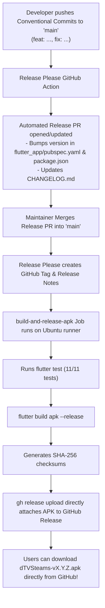

# GitHub Actions & Release Please CI/CD Guide

This repository is configured with **Google Release Please** (`googleapis/release-please-action@v4`) and automated Android APK releases directly to GitHub Releases.

---

## 🚀 How It Works

---

## ⚙️ Configuration Files

1. **[.github/workflows/release.yml](file:///C:/Users/Dylan/Documents/github/dTVSteams/.github/workflows/release.yml)**:
   - Workflow triggered on `push` to `main` and `workflow_dispatch` (manual run).
   - Grants `contents: write` and `pull-requests: write`.
   - Runs `release-please-action@v4`.
   - Compiles and attaches `dTVSteams-v<version>.apk`, `dTVSteams-release.apk`, and `checksums-sha256.txt` directly to the GitHub release.

2. **[release-please-config.json](file:///C:/Users/Dylan/Documents/github/dTVSteams/release-please-config.json)**:
   - Configures `flutter_app` with `release-type: "dart"`.
   - Generates clean semantic tags (`v1.0.0`, `v1.0.1`) without monorepo prefixes (`include-component-in-tag: false`).
   - Keeps `package.json` version in sync with `pubspec.yaml` via `extra-files`.

3. **[.release-please-manifest.json](file:///C:/Users/Dylan/Documents/github/dTVSteams/.release-please-manifest.json)**:
   - Tracks the current package version baseline.

---

## 📝 Conventional Commits Reference

Release Please calculates version increments based on commit message prefixes:

| Commit Prefix | SemVer Impact | Example | Result |
| :--- | :--- | :--- | :--- |
| `fix:` | **Patch** (`1.0.0` -> `1.0.1`) | `fix: resolve download stalling on slow networks` | Bug fix release |
| `feat:` | **Minor** (`1.0.0` -> `1.1.0`) | `feat: add parallel chunk download acceleration` | Feature release |
| `feat!:`, `fix!:`, `BREAKING CHANGE:` | **Major** (`1.0.0` -> `2.0.0`) | `feat!: redesign player engine architecture` | Breaking release |
| `chore:`, `docs:`, `style:`, `refactor:` | **No Release** | `chore: update dependencies` | Changes grouped into next release PR |

---

## 🔐 Required GitHub Repository Settings

To ensure Release Please has permission to create branches, pull requests, and releases:

1. Navigate to your GitHub repository: `https://github.com/dylansalim3/dTVSteams/settings/actions`
2. Scroll to **Workflow permissions**:
   - Select **Read and write permissions**.
   - Check **Allow GitHub Actions to create and approve pull requests**.
3. Click **Save**.

---

## 🕹️ Manual Release Trigger

If you ever need to manually trigger an APK build and attach it to the latest release without merging a PR:
1. Go to `Actions` -> `Release & Publish Android APK`.
2. Click `Run workflow`.
3. Check `Force build and attach APK even without a new Release PR`.
4. Click `Run workflow`.
